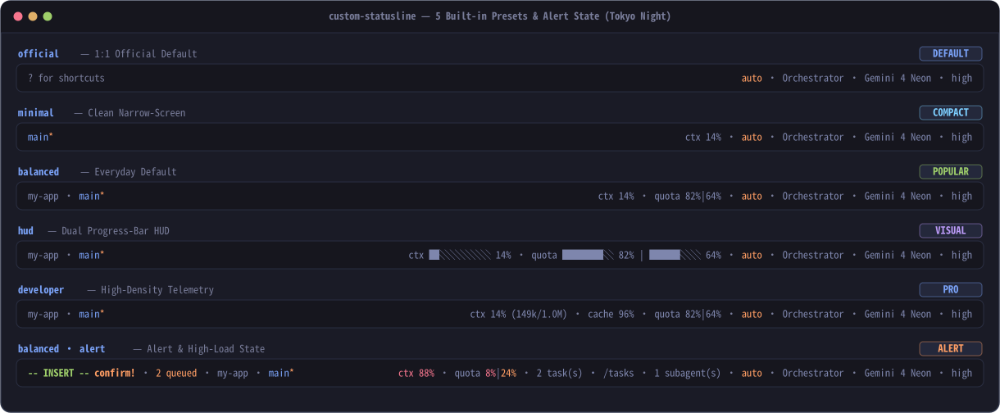
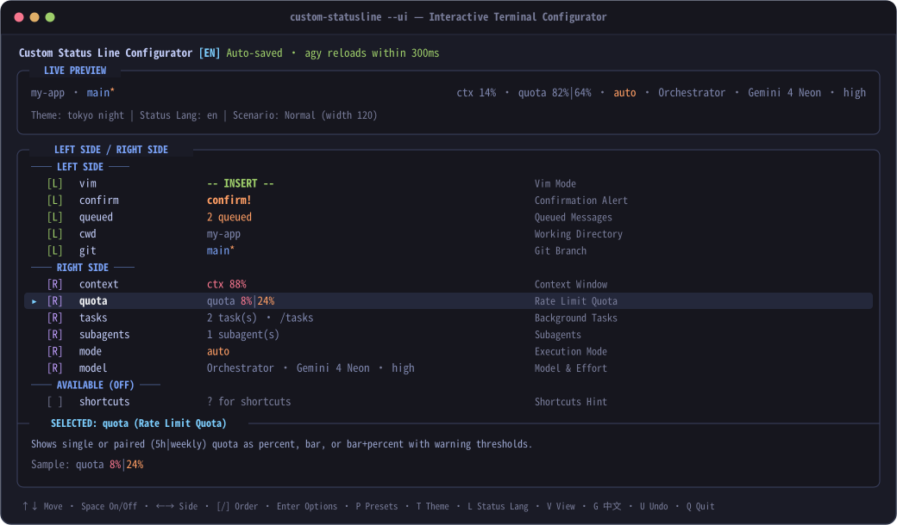

<div align="center">

English | [简体中文](./README.zh-CN.md)


# Custom Status Line (`custom-statusline`)

A modular, zero-dependency status line plugin for **Antigravity CLI (`agy`)** — featuring **19 composable widgets**, **5 presets**, and **8 built-in color palettes**, configured effortlessly via `/statusline-config` (agent-guided setup or one-click visual TUI).

[](https://github.com/ffyfox/agy-custom-statusline/actions/workflows/ci.yml)


[](./LICENSE)

</div>

<p align="center">
  
</p>

<p align="center">
  
</p>

## Highlights

- **Two Primary Ways to Configure (`/statusline-config`)**: Let the agent guide setup conversationally, or have `/statusline-config` pop open the real-color interactive TUI right in a terminal overlay/window — no long commands or manual JSON editing needed.
- **Theme Palettes & Responsive Layout**: Follows your `agy` theme automatically (8 built-in palettes; 10 `colorScheme` options) and compacts gracefully on narrow terminals without overflowing.
- **19 Configurable Widgets**: All 6 built-in widgets plus 13 extended widgets (`context`, `context_extra` cache/200k badges, 6 single & `5h|weekly` `quota` modes, `git`, `cwd`, `state`, `artifacts`, `queued`, `sandbox`, `cost`, `title`, `confirm`, `conversation_id`).
- **5 Ready-to-Use Presets**: `official`, `minimal`, `balanced`, `hud`, and `developer`.
- **True-Color Visual TUI Configurator**: Live preview, scenario & theme cycling, per-widget tuning, ~300 ms hot reload in `agy`, one-key session undo (`U`), and auto-opening across Kitty, tmux, Zellij, WezTerm, macOS, Linux, and Windows.
- **Independent Status Localization & JSON Schema**: Toggle rendered status labels (`statusLocale`: `en` | `zh` | `auto`) while keeping custom prefixes/texts, plus [schemas/statusline.schema.json](./schemas/statusline.schema.json) autocomplete.

## Quick Start

**Requirements:** Antigravity CLI (`agy`) and Node.js `>= 18` (zero npm dependencies).

1. **Install the plugin**
   ```bash
   agy plugin install https://github.com/ffyfox/agy-custom-statusline
   ```

2. **Run `/statusline-config` inside `agy`** — launches the setup wizard with two configuration paths:
   - **Agent-Guided Setup**: Stay in chat to switch presets, toggle/reorder widgets, tune colors & thresholds, diagnose issues, or uninstall — no commands to memorize.
   - **Visual TUI Configurator**: Let the wizard pop open the real-color keyboard editor right in a terminal overlay or window; changes auto-save within ~300 ms, `U` undoes the session, and `Q` returns straight to `agy`.

> On first run of `/statusline-config`, the agent asks to confirm and automatically enables the status line. Diagnostics, reset, and uninstall are also available inside `/statusline-config`. For standalone terminal CLI commands or scripting automation, see the [Full Reference Manual](./docs/reference.md#cli-reference).

## Presets

| Preset | Best For | Highlights |
| :--- | :--- | :--- |
| `official` | Official default look | `vim`, `shortcuts` \| `tasks`, `subagents`, `mode`, `model` |
| `minimal` | 80-col narrow terminals | `vim`, `confirm`, `git` \| `context` (`%`), `mode`, `model` |
| `balanced` | Everyday workflow | `cwd`, `git`, `confirm`, `queued` \| `context` (`%`), `quota` (`5h\|weekly`), `tasks`, `subagents`, `mode`, `model` |
| `hud` | Dual progress-bar HUD | `context` (`bar_percent` 6) + `quota` (`5h\|weekly` `bar_percent` 5) |
| `developer` | High-density telemetry | `context` (`tokens`), `context_extra` (`cache%`, `>200k`), `quota` (`5h\|weekly`) |

```text
official  : ? for shortcuts                                                    auto · Orchestrator · Gemini 4 Neon · high
minimal   : main*                                                    ctx 14% · auto · Orchestrator · Gemini 4 Neon · high
balanced  : my-app · main*                           ctx 14% · quota 82%|64% · auto · Orchestrator · Gemini 4 Neon · high
hud       : my-app · main*      ctx █░░░░░ 14% · quota ████░ 82% | ███░░ 64% · auto · Orchestrator · Gemini 4 Neon · high
developer : my-app · main*   ctx 14% (149k/1.0M) · cache 96% · quota 82%|64% · auto · Orchestrator · Gemini 4 Neon · high
```

> Applying a preset updates `left`/`right` and resets `widgets.*` to defaults, while keeping your `colorScheme`, separators, `locale`, and `statusLocale`.

## Documentation

Read the **[Full Reference Manual (docs/reference.md)](./docs/reference.md)** for:
- Standalone terminal CLI commands & shell quoting rules (`--install`, `--uninstall`, `--doctor`, `--gallery`, `--watch`, `--set`)
- Visual TUI main & sub-panel shortcuts + `--ui --open` terminal matrix & `Ctrl+Z` / `fg` fallback
- All 19 widgets & options, all 10 `colorScheme` values, config schema, environment variables, snapshot privacy, and troubleshooting

## Development & License

```bash
node test/verify.js
agy plugin validate --strict .
```

See [CHANGELOG.md](./CHANGELOG.md) · Released under the [MIT License](./LICENSE).
