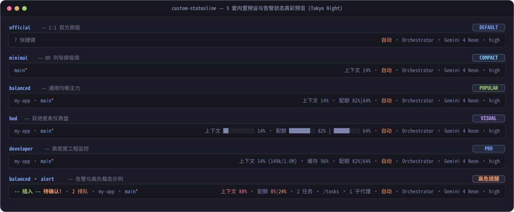
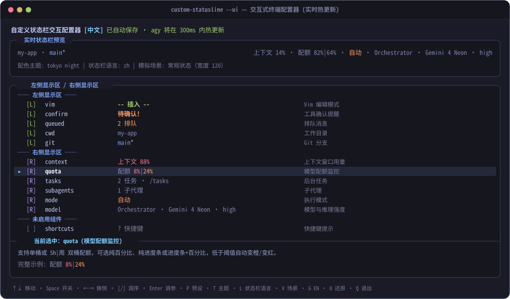

<div align="center">

[English](./README.md) | 简体中文


# 自定义状态栏插件 (`custom-statusline`)

一个零外部依赖、模块化的 **Antigravity CLI (`agy`)** 状态栏插件——提供 **19 个可自由组合的组件**、**5 套预设**与 **8 套内置配色方案**，只需在 `agy` 中输入 `/statusline-config` 即可由 Agent 对话配置或一键弹起真彩可视化 TUI 定制界面。

[](https://github.com/ffyfox/agy-custom-statusline/actions/workflows/ci.yml)


[](./LICENSE)

</div>

<p align="center">
  
</p>

<p align="center">
  
</p>

## 核心特性

- **两条主配置路径（统一入口 `/statusline-config`）**：既可在对话中让 Agent 引导完成配置，也可由 `/statusline-config` 一键在终端浮层/新窗口弹起真彩可视化 TUI——无需记忆冗长脚本路径，也不用手动改 JSON。
- **主题色板与窄屏自适应**：自动跟随 `agy` 配色（内置 8 套色板，共 10 个 `colorScheme` 可选值），窄屏终端下自动折叠不溢出。
- **19 个可组合组件**：覆盖 6 个官方组件与 13 个扩展组件（`context`、`context_extra` 缓存命中率/`>200k` 徽章、6 种单/双桶 `quota`、`git`、`cwd`、`state`、`artifacts`、`queued`、`sandbox`、`cost`、`title`、`confirm`、`conversation_id`）。
- **5 套内置预设模板**：`official`（官方原版）、`minimal`（极简专注）、`balanced`（均衡日常）、`hud`（双进度条仪表盘）、`developer`（高密度开发）。
- **真彩可视化配置 TUI**：实时预览、场景与主题切换、逐项调参、~300 ms 热更新、`U` 一键还原快照，并支持在 Kitty / tmux / Zellij / WezTerm 及主流桌面终端中自动拉起。
- **独立状态栏本地化与 Schema 校验**：独立切换状态栏标签语言（`statusLocale`: `en` | `zh` | `auto`）同时保留自定义文案，附带 [schemas/statusline.schema.json](./schemas/statusline.schema.json) 智能补全。

## 快速上手

**前置要求：** Antigravity CLI (`agy`) 与 Node.js `>= 18`（零外部依赖）。

1. **安装插件**
   ```bash
   agy plugin install https://github.com/ffyfox/agy-custom-statusline
   ```

2. **在 `agy` 中运行 `/statusline-config`** — 进入配置向导，并通向两条配置路径：
   - **Agent 对话引导配置**：直接说出你的需求（切换预设、增删/调整组件、配色与阈值、健康体检或卸载），零命令负担。
   - **可视化交互 TUI 配置**：由向导直接在浮层或新窗口拉起真彩键盘编辑器；改动约 300 ms 自动生效，`U` 一键撤销本次修改，按 `Q` 直接回到 `agy`。

> 首次运行 `/statusline-config` 时，Agent 会确认后自动完成状态栏启用；体检、重置与卸载同样可直接在 `/statusline-config` 中完成；如需在外部终端直接使用 CLI 或脚本自动化，请查阅 [完整参考手册](./docs/reference.zh-CN.md#命令行全参数指南)。

## 内置预设

| 预设名 | 适用场景 | 核心亮点 |
| :--- | :--- | :--- |
| `official` | 官方原版观感 | `vim`, `shortcuts` \| `tasks`, `subagents`, `mode`, `model` |
| `minimal` | 80 列窄屏专注 | `vim`, `confirm`, `git` \| `context` (`%`), `mode`, `model` |
| `balanced` | 通用均衡主力 | `cwd`, `git`, `confirm`, `queued` \| `context` (`%`), `quota` (`5h\|周`), `tasks`, `subagents`, `mode`, `model` |
| `hud` | 双进度条仪表盘 | `context` (`6格进度条+%`) + `quota` (`5h\|周` `5格进度条+%`) |
| `developer` | 高密度工程监控 | `context` (`token比例`), `context_extra` (`命中率`, `>200k`), `quota` (`5h\|周`) |

```text
official  : ? 快捷键                                                            自动 · Orchestrator · Gemini 4 Neon · high
minimal   : main*                                                  上下文 14% · 自动 · Orchestrator · Gemini 4 Neon · high
balanced  : my-app · main*                          上下文 14% · 配额 82%|64% · 自动 · Orchestrator · Gemini 4 Neon · high
hud       : my-app · main*     上下文 █░░░░░ 14% · 配额 ████░ 82% | ███░░ 64% · 自动 · Orchestrator · Gemini 4 Neon · high
developer : my-app · main*   上下文 14% (149k/1.0M) · 缓存 96% · 配额 82%|64% · 自动 · Orchestrator · Gemini 4 Neon · high
```

> 套用预设会更新 `left`/`right` 布局并重置 `widgets.*` 参数为默认值，同时保留你当前的 `colorScheme`、分隔符、`locale` 与 `statusLocale`。

## 详细文档

完整参考请查阅 **[完整参考手册 (docs/reference.zh-CN.md)](./docs/reference.zh-CN.md)**，涵盖：
- 外部终端 CLI 全命令与引号规范（`--install`、`--uninstall`、`--doctor`、`--gallery`、`--watch`、`--set`）
- 可视化 TUI 主视图与子面板快捷键、`--ui --open` 终端支持矩阵及 `Ctrl+Z` / `fg` 降级操作
- 19 个组件全部参数、10 个 `colorScheme` 枚举值、配置文件结构、环境变量、实时快照隐私说明与故障排查

## 开发与开源协议

```bash
node test/verify.js
agy plugin validate --strict .
```

更新记录见 [CHANGELOG.md](./CHANGELOG.md) · 基于 [MIT 协议](./LICENSE) 开源。
